<p align="center">

</p>

<p align="center">

</p>

<p align="center">

</p>

<p align="center">


</p>

<p align="center">


</p>

<p align="center">
<a href="#-sobre"># sobre</a>
&nbsp;&nbsp;
<a href="#-preview"># preview</a>
&nbsp;&nbsp;
<a href="#-comandos"># comandos</a>
&nbsp;&nbsp;
<a href="#-galeria"># galeria</a>
&nbsp;&nbsp;
<a href="#-rodando-localmente"># rodar-localmente</a>
</p>

<p align="center">
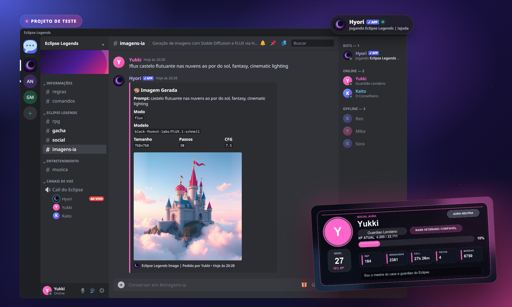
</p>

> [!WARNING]
> **Isto é só um teste.** A Hyori é um projeto pessoal de estudo. Ela **não está online, não vai ao ar e não tem link de convite**: o bot só roda localmente, na máquina de quem tiver o código e o próprio token. Os tokens originais **não** estão neste repositório.

---

## 🌑 Sobre

A **Hyori** é um bot de Discord em Python que transforma o servidor num mundo de RPG chamado **Eclipse Legends**. Tudo acontece pelo chat, com comandos de prefixo `!` e respostas em embeds:

| ⚔️ RPG | 🎰 Gacha | 💜 Social | 🎧 Extras |
| :---: | :---: | :---: | :---: |
| Classes, raças, batalhas por turno, guildas, PvP e boss mundial | Colecione 79 mil personagens de anime com raridades e pity | XP por mensagem e call, reputação, títulos e card de perfil | Música do YouTube na call e imagens geradas com IA |

<sub>Os prints deste README foram gerados a partir das respostas reais do bot, rodando localmente com dados de teste.</sub>

## 🎞️ Preview

<p align="center">
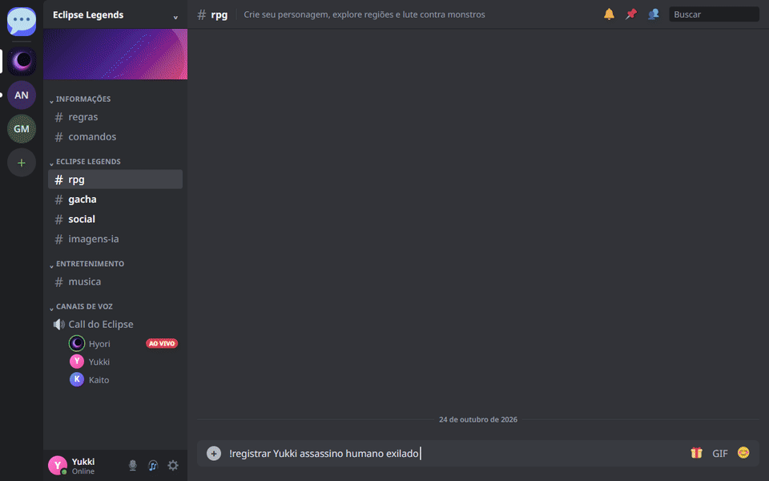
</p>

## 💬 Comandos

> Prefixo padrão: `!` · use `!ajuda` no servidor para ver tudo.

<details open>
<summary><b>⌄ PERSONAGEM</b></summary>
<br>

| Comando | O que faz |
| --- | --- |
| `!registrar Nome classe raca origem` | Cria seu personagem |
| `!personagem` · `!status` | Mostra HP, mana, energia, atributos e equipamentos |
| `!classes` · `!racas` · `!origens` | Lista as opções de criação |
| `!upar atributo qtd` | Distribui pontos livres |
| `!inventario` · `!equipar item` | Gerencia itens |

</details>

<details>
<summary><b>⌄ AVENTURA</b></summary>
<br>

| Comando | O que faz |
| --- | --- |
| `!explorar regiao` | Explora floresta, caverna, castelo, inferno ou céu |
| `!batalhar regiao` | Batalha por turnos contra monstros da região |
| `!habilidades` · `!usar item` | Skills da classe e consumíveis |
| `!quest` · `!historia escolha` | Missões e história |
| `!boss status/atacar` · `!eventos` | Boss mundial e eventos dinâmicos |
| `!daily` · `!descansar` | Recompensa diária e recuperação |

</details>

<details>
<summary><b>⌄ ECONOMIA, GUILDAS E PVP</b></summary>
<br>

| Comando | O que faz |
| --- | --- |
| `!loja` · `!comprar` · `!vender` | Loja do Eclipse |
| `!mercado listar/vender/comprar` | Mercado entre jogadores |
| `!guilda criar/entrar/perfil/canal` | Guildas |
| `!pvp @usuario ranqueado` · `!ranking` | Duelos e ranking |
| `!evoluir` · `!transformar` · `!reencarnar` | Progressão avançada |

</details>

<details>
<summary><b>⌄ GACHA ANIME</b></summary>
<br>

| Comando | O que faz |
| --- | --- |
| `!checkin` | Cristais e tickets diários |
| `!gacha roll 1` · `!gacha roll 10` | Invoca personagens (multi garante épico+) |
| `!gacha perfil` · `!gacha colecao` · `!gacha ver nome` | Sua coleção |
| `!gacha vender` · `!gacha ranking` · `!gacha banner` | Venda, ranking e taxas |

</details>

<details>
<summary><b>⌄ PERFIL SOCIAL</b></summary>
<br>

| Comando | O que faz |
| --- | --- |
| `!perfil` · `!perfil @usuario` | Gera o card de perfil em imagem |
| `!rep @usuario tipo` · `!elogiar @usuario` | Reputação |
| `!rank xp/nivel/rep/mensagens/call/semanal/mensal` | Rankings |
| `!titulo escolher "A Lenda"` · `!perfil editar bio texto` | Personalização |

</details>

<details>
<summary><b>⌄ MÚSICA E IMAGEM</b></summary>
<br>

| Comando | O que faz |
| --- | --- |
| `!entrar` · `!tocar nome/link` · `!playlist link` | Toca na call |
| `!fila` · `!pausar` · `!continuar` · `!proxima` · `!sair` | Controle do player |
| `!imagem prompt` · `!flux prompt` | Gera imagem com Stable Diffusion ou FLUX |
| `!imageminfo` · `!imagemmodelos` | Opções (`--wide`, `--vertical`, `--seed`...) |

</details>

## 🖼️ Galeria

<table>
<tr>
<td width="50%">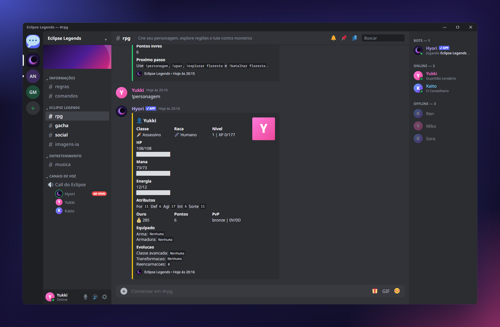</td>
<td width="50%">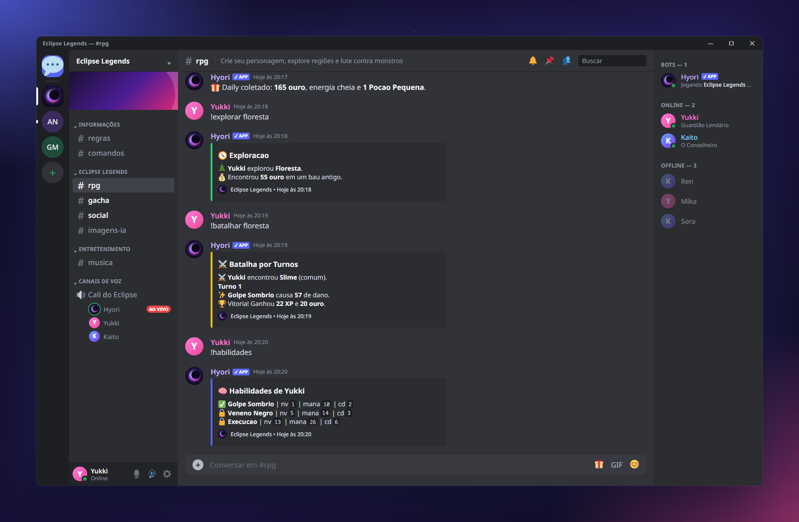</td>
</tr>
<tr>
<td align="center"><b>#rpg · personagem</b><br><sub><code>!registrar</code> e <code>!personagem</code></sub></td>
<td align="center"><b>#rpg · aventura</b><br><sub><code>!daily</code>, <code>!explorar</code>, <code>!batalhar</code> e <code>!habilidades</code></sub></td>
</tr>
<tr>
<td width="50%">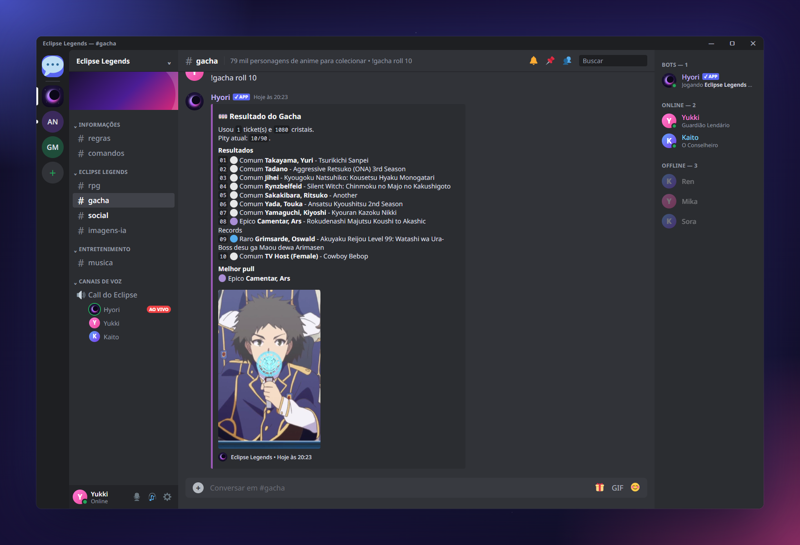</td>
<td width="50%">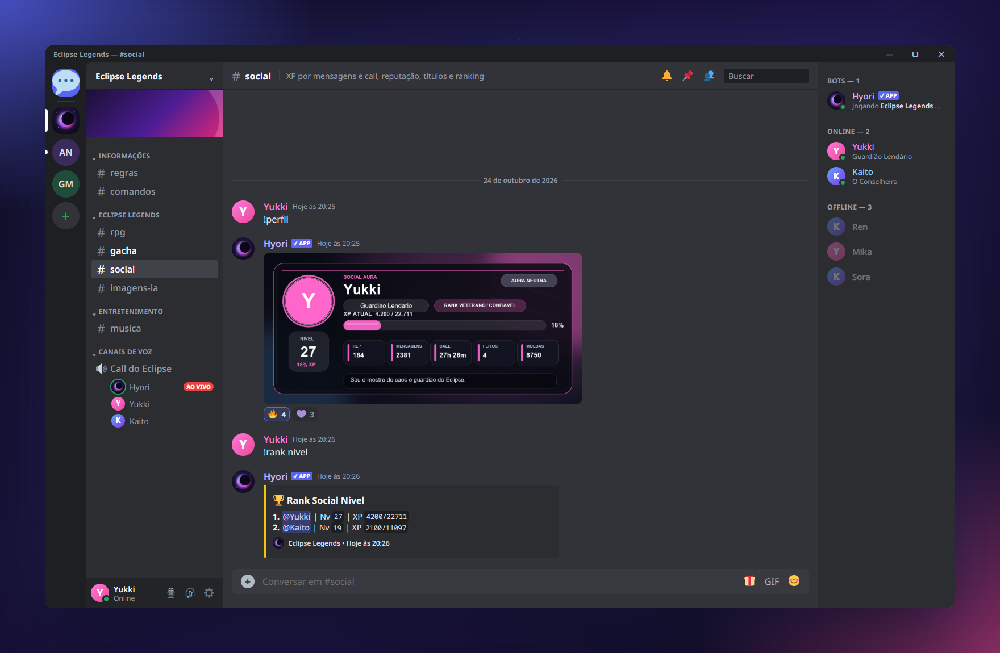</td>
</tr>
<tr>
<td align="center"><b>#gacha</b><br><sub><code>!checkin</code> e multi de 10 com imagem do melhor pull</sub></td>
<td align="center"><b>#social</b><br><sub>Card de perfil gerado com Pillow e ranking</sub></td>
</tr>
<tr>
<td width="50%">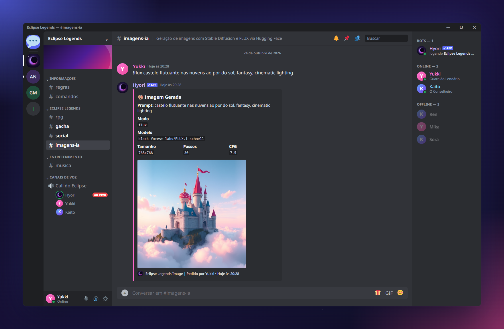</td>
<td width="50%">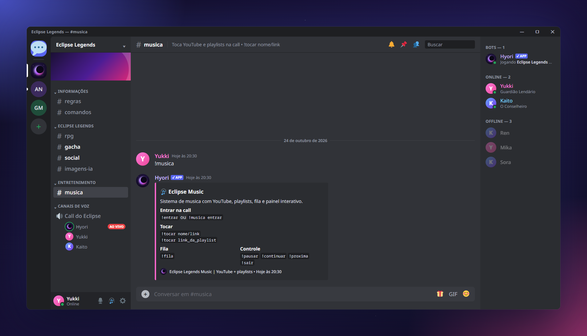</td>
</tr>
<tr>
<td align="center"><b>#imagens-ia</b><br><sub><code>!flux</code> com FLUX.1 Schnell via Hugging Face</sub></td>
<td align="center"><b>#musica</b><br><sub>Painel de música com YouTube e playlists</sub></td>
</tr>
<tr>
<td colspan="2">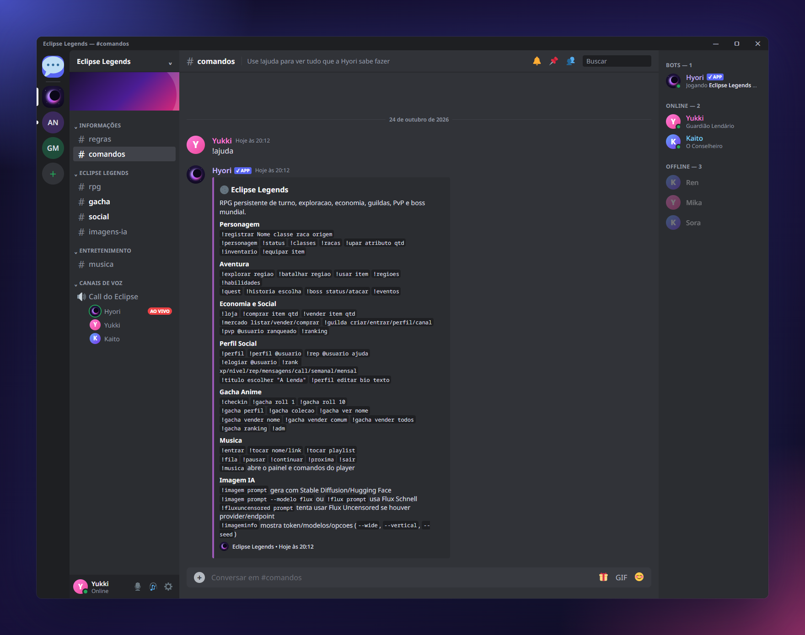</td>
</tr>
<tr>
<td colspan="2" align="center"><b>#comandos</b><br><sub>O <code>!ajuda</code> completo</sub></td>
</tr>
</table>

### 🎨 Feito com `!imagem`

<table>
<tr>
<td width="25%"></td>
<td width="25%">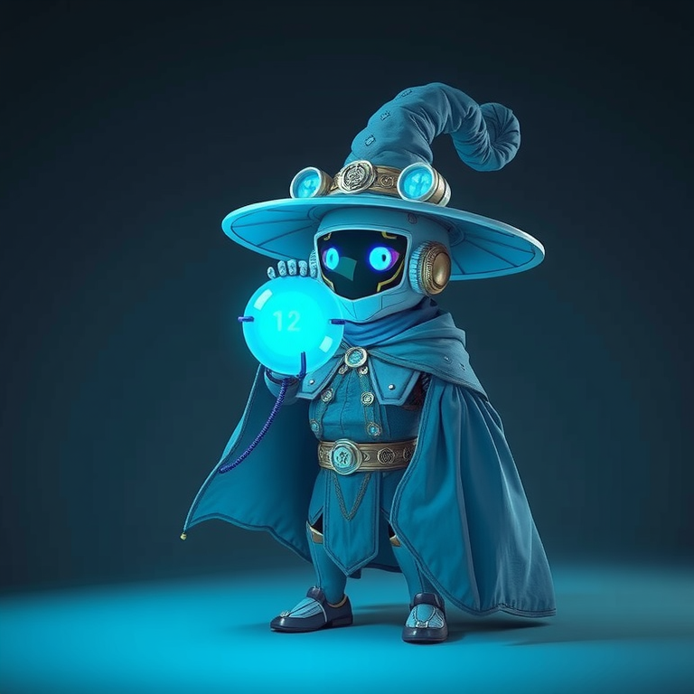</td>
<td width="25%">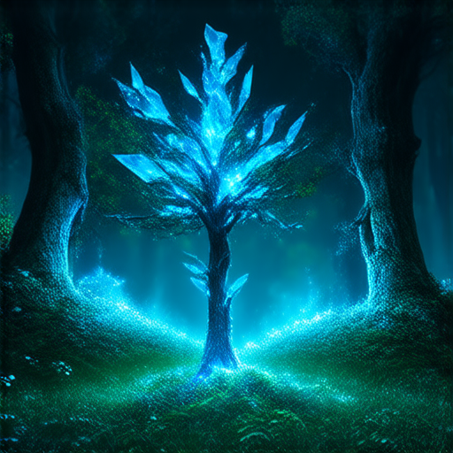</td>
<td width="25%">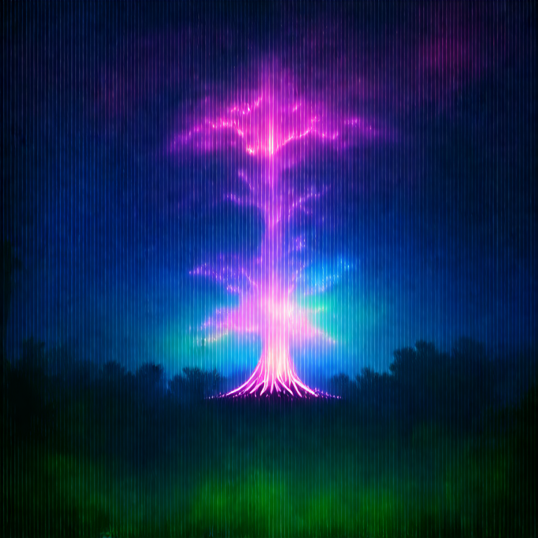</td>
</tr>
<tr>
<td align="center"><sub>FLUX.1 Schnell</sub></td>
<td align="center"><sub>FLUX.1 Schnell</sub></td>
<td align="center"><sub>Stable Diffusion 3</sub></td>
<td align="center"><sub>Stable Diffusion 3</sub></td>
</tr>
</table>

## 🧩 Como funciona

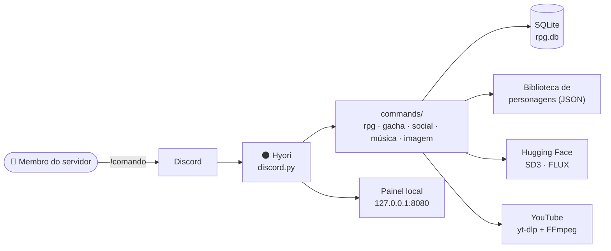

<details>
<summary><b>Estrutura do projeto</b></summary>
<br>

```text
hyori-bot/
├── bot.py                  ponto de entrada
├── bot.bat                 prepara o ambiente e inicia (Windows)
├── requirements.txt
├── .env.example            modelo das variáveis
└── eclipse_legends/
    ├── app.py              carrega módulos e roda o bot
    ├── core.py             configurações, constantes e dados base
    ├── database.py         SQLite, tabelas e migrações
    ├── rpg.py · gacha.py · social.py · music.py
    ├── image_generation.py Hugging Face / Stable Diffusion / FLUX
    ├── local_server.py     página de status local
    ├── events.py           eventos do Discord
    └── commands/           help · economia · aventura · quests · guildas
                            social · gacha/admin · imagens · utilidades
```

</details>

## 💻 Rodando localmente

> É um projeto de teste: para usar, você precisa criar **o seu próprio** bot no Discord Developer Portal.

```bash
git clone https://github.com/Yuyusukii/hyori-bot.git
cd hyori-bot
python -m venv .venv
.venv\Scripts\activate
pip install -r requirements.txt
```

Crie um arquivo `.env.local` (ele já está no `.gitignore`):

```env
DISCORD_TOKEN=seu_token_do_discord
HUGGINGFACE_TOKEN=seu_token_da_huggingface
```

```bash
python bot.py
```

No Windows dá para simplesmente abrir o `bot.bat`: ele cria o ambiente, instala as dependências e inicia o bot. Enquanto o bot estiver aberto, o painel de status fica em **http://127.0.0.1:8080**.

<details>
<summary><b>Variáveis disponíveis</b></summary>
<br>

| Variável | Para que serve |
| --- | --- |
| `DISCORD_TOKEN` | Token do bot |
| `HUGGINGFACE_TOKEN` | Token da Hugging Face para gerar imagens |
| `HF_IMAGE_MODEL` | Modelo padrão (Stable Diffusion 3 Medium) |
| `HF_IMAGE_MODEL_FLUX` | Modelo do `--modelo flux` (FLUX.1 Schnell) |
| `LOCAL_SERVER_ENABLED` | Liga/desliga o painel local |
| `LOCAL_SERVER_HOST` · `LOCAL_SERVER_PORT` | Endereço do painel (padrão `127.0.0.1:8080`) |

Veja todas no [`.env.example`](.env.example).

</details>

## ⚖️ Aviso

- 🧪 Projeto **de teste**, sem fins comerciais. **Não está online, não vai ao ar e não aceita convites.**
- 🔑 Nenhum token, banco de dados ou dado de usuário foi publicado. Use sempre as suas próprias chaves.
- 🗂️ Personagens, nomes e imagens de anime pertencem aos respectivos detentores.
- 🎧 O player de música é só para testes pessoais. Respeite os termos de uso das plataformas.

<p align="center">

</p>

<p align="center">
<sub>feito por <a href="https://github.com/Yuyusukii">Yukki</a> · 2026 · só um teste, não vai ao ar 💜</sub>
</p>

<p align="center">

</p>
